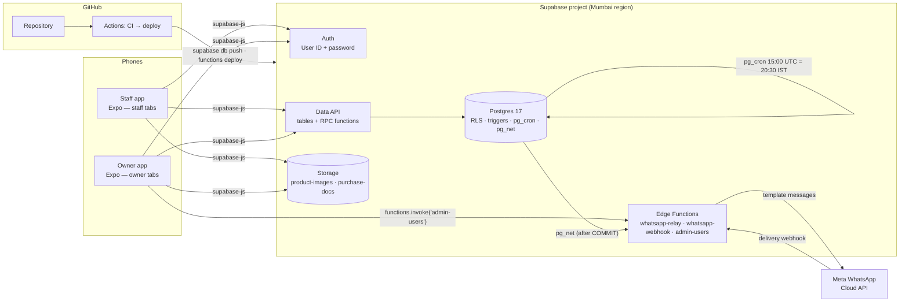
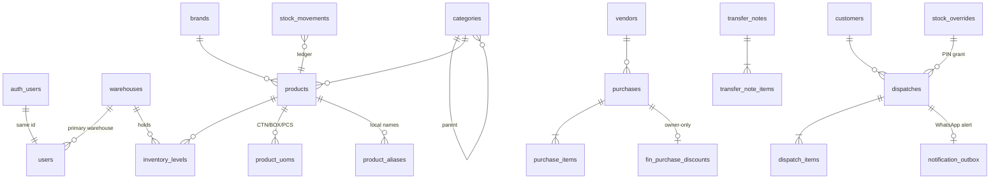

# WH Reg — Architecture (Supabase + GitHub)

Mobile inventory & dispatch for a multi-warehouse hardware distributor: no barcodes, carton/box/piece
units, GST-correct inward/outward, strict employee/owner data separation, WhatsApp alerts.

**Everything runs on two platforms:**
- **Supabase** hosts the database, logins, file storage, background functions and schedules.
- **GitHub** holds the code, runs the tests on every change, and deploys to Supabase.

There is no separate server to rent or maintain.

---

## 1. System overview



**Design principle: the database is the security and integrity boundary.**
The app only shows or hides screens. Postgres refuses everything else: an employee cannot see a
cost price, oversell stock, back-date an invoice or post into another warehouse, whatever request
reaches it. This is proven by 90 automated checks (`supabase/tests/rls_and_rules_test.sql`), which
CI runs against a real local Supabase stack on every push.

## 2. Stack

| Layer | Choice | Notes |
|---|---|---|
| Mobile | Expo SDK 58 / React Native 0.88, expo-router, TanStack Query, Zustand | Android first; iOS from the same code |
| Backend client | `@supabase/supabase-js` 2 | Sessions are encrypted at rest: an AES key is kept in the OS keystore and the session itself in AsyncStorage |
| Auth | Supabase Auth, email+password provider | Staff type a **User ID**; the app maps it to `<id>@staff.whreg.app`. Self sign-up is off, and the owner creates logins. |
| Business logic | Postgres functions (`supabase/migrations/*_api.sql`) | Atomic multi-table writes, GST maths, stock locking |
| Analytics | `fin` schema views/functions, reached through `owner_*` RPCs | `fin` is not exposed by the Data API |
| Files | Supabase Storage | `product-images` (public), `purchase-docs` (private, per-warehouse folders) |
| Background | Edge Functions (Deno) + `pg_net` + `pg_cron` + Vault | WhatsApp relay, Meta webhook, owner user admin |
| CI/CD | GitHub Actions + Supabase CLI v3 + Expo EAS | Tests on every PR; deploys on merge to `main` |
| Shared code | `packages/shared` | GST, UoM and GSTIN logic plus Zod form schemas, used by the app |

## 3. Security model

### 3.1 Roles (Supabase built-ins)
| Role | Who | Can do |
|---|---|---|
| `anon` | anyone with the app but not signed in | **nothing**. Every table and function grant is revoked; tests assert zero privileges. |
| `authenticated` | every signed-in staff member **and** owner | narrow table grants + staff/owner RPCs; **RLS decides rows**, keyed on `auth.uid()` → `users.role` / `users.primary_warehouse_id` |
| `service_role` / secret key | Edge Functions only | the `wa_*` worker RPCs and Auth admin. Never shipped in the app. |

Owners and employees share the `authenticated` role, so the database tells them apart **only** from
the `users` table (`app.is_owner()`, `app.current_warehouse_id()`), never from anything the device sends.

### 3.2 Layers
| Layer | Mechanism | Stops |
|---|---|---|
| App | role-based tab groups `(staff)` / `(owner)` | accidental navigation (UX only — not trusted) |
| Grants | Supabase's default grants revoked; only listed tables and functions granted. `fin`, `secure` and `app` schemas aren't exposed or granted. | raw queries against finance tables, PIN hashes, the outbox, the audit log or internal functions fail with *permission denied* |
| RLS | policies on every table (`staff_*`, `owner_all`) | other warehouses' stock, other people's entries, past days |
| RPC guards | every `owner_*` function starts with `app.require_owner()`; staff RPCs force the warehouse | employees calling owner functions → `WH002` |
| Triggers | server sets `created_by`, dates, invoice no., UoM factor, tax split, totals; CHECK constraints on GST maths | tampered payloads |

### 3.3 What each role can see
| Data | Employee | Owner/Admin |
|---|---|---|
| Physical stock counts | own warehouse | all warehouses |
| Catalogue, photos, local aliases, list selling price | ✓ (can add aliases, customers, vendors) | ✓ full edit |
| Own inward/outward entries | **today (IST) only** | all, any date |
| Purchase costs, last purchase price, stock valuation, margins, turnover, graphs | ✗ | ✓ via `owner_*` RPCs |
| Owner's extra purchase discount / net cost | ✗ | ✓ |
| Lorry-receipt photos | upload only (own warehouse folder) | upload + view |
| Cancel invoices, adjust stock, manage logins, set PIN | ✗ | ✓ |
| Edit money/qty on a saved document | ✗ | ✗ (cancel & re-issue; only logistics fields are editable) |
| Password hashes / override PIN hashes | ✗ | ✗ (owners can *set* them, never *read* them) |

### 3.4 Admin Override PIN
1. `create_dispatch` checks every line and raises `WH001` with **all** shortfalls (JSON in `error.details`).
2. The Owner/Admin enters their 6–8 digit PIN on the device → `request_stock_override` RPC.
3. The PIN is checked against bcrypt hashes in `secure.override_pins`. A wrong PIN returns `{ok:false}` (not an error, so the attempt is committed). **5 wrong attempts in 15 minutes locks the requester** (`WH003`).
4. The PIN unlocks one dispatch only. It expires after **10 minutes** and is tied to that employee and warehouse. It's consumed on use and audited, and the invoice is flagged `used_override`.

## 4. Data model



| Decision | Detail |
|---|---|
| Ledger + levels | `stock_movements` is an append-only record of every stock change. `inventory_levels` holds the current count and is updated by one function that locks the row, so two counters can never oversell the same item. |
| Base units | All stock is stored in the base unit (PCS); `product_uoms.factor_to_base` converts (e.g. CTN = 2000). The factor is copied onto each line by the server. |
| Prices | Unit prices are kept to 4 decimals and amounts to 2 (Postgres rounding). `packages/shared/gst.ts` mirrors the generated columns exactly. |
| GST slabs are data | `gst_rates`: 0/5/12/18/28 as specified, plus 40 (inactive). Since GST 2.0 (22-Sep-2025), 12% and 28% are largely retired, so the owner can switch slabs off without a code change. |
| CGST+SGST vs IGST | Decided automatically from the warehouse state and the GSTIN state of the vendor or customer. |
| Invoice numbers | `WHA/26-27/00042` per warehouse per financial year (≤ 16 chars, as GST requires). |
| Finalised at COMMIT | Totals, the "at least one line" rule and the WhatsApp outbox row are written when the transaction commits. An alert is never sent for a sale that was rolled back. |
| Idempotent writes | Each form sends a `clientTxnId` generated on the device. A retry returns the original document instead of creating a duplicate. |
| Transfers | `DRAFT → IN_TRANSIT → RECEIVED`. Shortages are recorded and visible to the owner. |
| Cost basis | Weighted average, **excluding GST** (input tax credit), net of the owner's discount, plus freight. Used for valuation and margins. |

## 5. Repository layout

```
WH Reg/
├── .github/workflows/
│   ├── ci.yml            every PR/push: shared tests, app typecheck, Deno check/tests,
│   │                     real `supabase start` + DB test-suite + plpgsql lint
│   ├── deploy.yml        on main: CI → supabase db push → functions deploy (→ config push)
│   └── mobile.yml        manual: EAS cloud build (APK for testing / AAB for Play Store)
├── supabase/
│   ├── config.toml       auth (no sign-up, 10-char passwords), storage buckets, function settings
│   ├── migrations/
│   │   ├── …0100_foundation.sql          extensions, private schemas, enums, GSTIN checksum
│   │   ├── …0200_schema.sql              all tables, keys, CHECKs, generated GST columns, indexes
│   │   ├── …0300_functions_triggers.sql  auth.uid() identity, search, stock engine, PIN, transfers
│   │   ├── …0400_rls.sql                 revoke Supabase defaults, minimal grants, RLS policies
│   │   ├── …0500_analytics.sql           fin.*: valuation, reorder, sales, margins, dead stock, EOD
│   │   ├── …0600_api.sql                 the app's RPCs (staff, owner_*, wa_*) + function allow-list
│   │   └── …0700_storage_and_jobs.sql    buckets + policies, pg_net relay trigger, pg_cron schedules
│   ├── seed.sql          dev data incl. Auth users (local `supabase db reset` only)
│   ├── functions/
│   │   ├── _shared/      supabase admin client, WhatsApp templates/sender/signature check
│   │   ├── whatsapp-relay/     drains the outbox → Meta Cloud API
│   │   ├── whatsapp-webhook/   Meta delivery statuses (HMAC verified)
│   │   ├── admin-users/        owner creates logins / resets passwords / disables staff
│   │   ├── tests/              Deno unit tests
│   │   └── .env.example        function secrets template
│   └── tests/
│       ├── rls_and_rules_test.sql   90 checks
│       ├── run.sh                   --supabase (real stack) | --plain (any Postgres)
│       └── stub/                    minimal Supabase emulation for --plain
├── packages/shared/src/  gst.ts · uom.ts · india.ts · schemas.ts · errors.ts (+ tests)
├── apps/mobile/
│   ├── app/(auth) · (staff)/{stock,outward,inward,transfers,log} · (owner)/{dashboard,reorder,stock,purchases,insights,team}
│   ├── src/lib/supabase.ts   client, encrypted session store, User-ID→email mapping
│   ├── src/api/client.ts     rpc() / q() / edge() wrappers, error mapping, receipt upload
│   ├── src/components/       ItemPicker, PriceGstField, QtyUomField, OverridePinSheet, charts
│   ├── eas.json · .env.example
└── docs/ ARCHITECTURE.md · ROADMAP.md · WHATSAPP.md
```

## 6. Backend API (what the app calls)

Called as `supabase.rpc('<name>', args)` unless noted.

| Area | Calls |
|---|---|
| Session | `auth.signInWithPassword` · `me()` |
| Catalogue | `search_items(q, lim, brand_id, category_id)` · `catalog_tree()` · `add_product_alias(...)` · tables `gst_rates`, `warehouses`, `sales_agents`, `customers`, `vendors` (select / insert) |
| Stock | `stock_list(p_warehouse, p_low_only)` · `request_stock_override(p_pin, p_reason)` |
| Inward | Storage upload to `purchase-docs/<warehouse>/<yyyy-mm>/<id>.jpg` → `create_purchase(p)` |
| Outward | `check_dispatch(p)` · `create_dispatch(p)` |
| Transfers | `create_transfer(p)` · `dispatch_transfer(p_note)` · `receive_transfer(p_note, p_lines)` · `list_transfers(p_status)` |
| My day | `my_day()` |
| Owner | `owner_stock_overview` · `owner_reorder_alerts` · `owner_create_purchase_orders` · `owner_sales_trend` · `owner_top_items` · `owner_margins` · `owner_dead_stock` · `owner_staff_performance` · `owner_customer_ledger` · `owner_purchases_net` · `owner_set_purchase_discount` · `owner_adjust_stock` · `owner_cancel_dispatch` · `owner_cancel_purchase` · `owner_set_override_pin` · `owner_list_users` · `owner_update_user` · `owner_notifications` |
| Owner (Edge) | `functions.invoke('admin-users', { action: 'create' \| 'set_password' \| 'set_active', … })` |
| Worker (secret key) | `wa_claim_outbox` · `wa_mark_sent` · `wa_mark_failed` · `wa_status_update` · `wa_dispatch_payload` · `wa_eod_payload` |

Errors arrive as `error.code` = `WH001` (insufficient stock; `details` = shortfalls), `WH002` (forbidden),
`WH003` (PIN locked), `WH005` (validation), `42501` (no privilege), `23505` (duplicate) and `23514` (bad GST maths).

**The owner also gets Supabase Studio for free.** The Table Editor is a ready-made admin screen for
bulk master data: products, aliases, pack sizes, reorder levels and price lists.

## 7. Interpretations of the brief (please confirm)
| Brief says | Implemented as |
|---|---|
| Dispatch alert "Vendor Name GST" | **Customer GSTIN** (a sale has no vendor) |
| "Discount Amount %" | Percentage per line; the ₹ amount is shown |
| Employees see "their own daily transaction logs" | Their own entries from **today (IST)** |
| EOD "Warehouse A / Warehouse B" | One total per active warehouse |
| Owner purchase discount | Per purchase (% or ₹), spread across lines by value |
| Owner vs Admin | Same powers |
| User ID + password login | Supabase Auth email provider with a fixed internal domain; staff never see an email address |

## 8. Compliance notes (verify with your CA)
- **E-way bill** above ₹50,000 per consignment: `eway_bill_no` fields exist; generating them via NIC is on the roadmap.
- **E-invoicing (IRN/QR)** above the notified turnover threshold: on the roadmap, via a GSP.
- **Inter-state branch transfers** between different GSTINs are taxable supplies and need a tax invoice. Same-GSTIN moves travel under a delivery challan.
