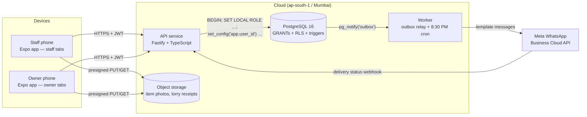
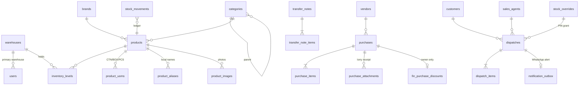

# WH Reg — Architecture

Mobile inventory & dispatch for a multi-warehouse hardware distributor.
No barcodes, no aisle system, GST-compliant inward/outward, strict employee/owner data separation, and WhatsApp alerts.

---

## 1. System overview



**Design principle: the database is the security and integrity boundary, not the app.**
The mobile app hides screens; the API checks roles; but even a buggy API cannot show an employee
a cost price, oversell stock, back-date an invoice, or post into another warehouse, because
Postgres refuses it. 60+ automated SQL tests prove this (`db/tests/rls_and_rules_test.sql`).

## 2. Stack

| Layer | Choice | Why |
|---|---|---|
| Mobile | **Expo SDK 58 / React Native 0.88**, expo-router, TanStack Query, Zustand | One codebase for Android (most floor phones) and iOS; OTA updates; secure keystore storage |
| Charts | react-native-gifted-charts (SVG) | Light, no native Skia dependency |
| API | **Node 22 + Fastify 5 + Zod 4** | Fast, typed; Zod schemas shared with the app |
| DB | **PostgreSQL 16** | RLS, generated columns, deferred triggers, trigram search — all used heavily |
| Search | `pg_trgm` + vernacular alias table | Typo-tolerant search without running Elasticsearch |
| Jobs | Worker process: `LISTEN/NOTIFY` + `croner` (tz Asia/Kolkata) | No Redis needed; outbox lives in Postgres |
| Files | S3-compatible (AWS S3 Mumbai / Cloudflare R2 / MinIO locally) | Direct device uploads via presigned URLs |
| Auth | User ID + password (argon2id), 15-min JWT + rotating refresh tokens | Matches "User ID and Password" requirement; reuse detection kills stolen sessions |
| Monorepo | pnpm workspaces + Turborepo | `packages/shared` holds GST maths, UoM, GSTIN validation, request schemas |

## 3. Security model (RBAC + RLS)

### 3.1 Three layers

| Layer | Mechanism | What it stops |
|---|---|---|
| 1. App | Role-based tab groups `(staff)` / `(owner)` | Accidental navigation (UX only — not trusted) |
| 2. API | JWT `requireOwner` on every `/v1/owner/*` route | Employee calling owner endpoints → 403 |
| 3a. DB GRANTs | `SET LOCAL ROLE app_employee` has **no USAGE on schema `fin`**, no access to `auth.*`, `audit_log`, outbox, stock adjustments, or internal functions | Even a hand-written SQL query fails with *permission denied* |
| 3b. DB RLS | Policies keyed on `app.current_user_id()` / `app.current_warehouse_id()`, read from `users` (not from the JWT) | Rows of other warehouses, other people's entries, or past days |

Every **owner** policy also re-checks `app.is_owner()` from the `users` table, so if the API mistakenly
opened an owner-role session for an employee, they would still see zero rows (tested).

### 3.2 Database roles

| Role | Login | Used for |
|---|---|---|
| `migrator` (schema owner) | yes | Migrations only. Never used by the running API. |
| `app_api` | yes, `NOINHERIT` | The API's only connection. Has **no** privileges of its own. |
| `app_employee` | no | `SET LOCAL ROLE` for floor staff requests |
| `app_owner` | no | Owner/Admin requests and the worker (as the `SYSTEM` user) |
| `app_auth` | no | Login/refresh only: can read password hashes, nothing else |

`SET LOCAL` + `set_config(..., true)` are transaction-scoped, so pooled connections can never leak identity between requests.

### 3.3 What each role can see

| Data | Employee | Owner/Admin |
|---|---|---|
| Physical stock counts | Own warehouse only | All warehouses |
| Catalogue, photos, aliases, list (selling) price | ✓ (can add aliases, customers, vendors) | ✓ full edit |
| Own inward/outward entries | **Today (IST) only, own entries only** | All, any date |
| Other employees' entries | ✗ | ✓ |
| Purchase cost history, last purchase price, valuation | ✗ (`fin` schema invisible) | ✓ |
| Owner's extra purchase discount / net cost | ✗ | ✓ (`fin.purchase_discounts`) |
| Turnover, revenue, margins, graphs, staff performance | ✗ | ✓ |
| Customer ledger & payments | ✗ | ✓ |
| Stock adjustments (damage/loss/audit/opening) | ✗ | ✓ |
| Cancel an invoice / purchase | ✗ | ✓ (reversal movements, never deletes) |
| Edit invoice money/qty after saving | ✗ | ✗ (cancel & re-issue; only logistics fields editable) |
| Password hashes / override PIN hashes | ✗ | ✗ (owners can *set*, never *read*) |

### 3.4 Anti-tampering rules enforced by triggers
- `created_by`, `created_at`, `status`, totals, tax split, invoice number, and UoM conversion factor are **always set by the server**, whatever the device sends.
- Staff cannot back-date: `invoice_date` / `received_on` forced to today (IST) for non-owners.
- Lines can only be added in the same transaction that created the document → saved documents are immutable.
- `unit_incl_price` must equal `unit_base_price × (1 + GST%)` within ₹0.01 (CHECK constraint).
- GST slab must exist in `gst_rates` (FK).
- GSTIN validated with the official mod-36 checksum, in SQL **and** TypeScript.

### 3.5 Admin Override PIN (dispatch beyond stock)
1. App submits dispatch → API pre-checks all lines → `409 INSUFFICIENT_STOCK` with every shortfall.
2. Owner/Admin enters their 6–8 digit PIN on the device → `POST /overrides` → `app.request_stock_override()`.
3. PIN verified against bcrypt hashes inside Postgres; **5 wrong attempts in 15 min locks the requester** (the failed attempt is committed before the error is returned).
4. Returns a grant that is **single-use, 10 minutes, bound to that employee + warehouse**.
5. Resubmitting with `overrideId` lets the stock trigger go negative; the grant is consumed and audited; the invoice is flagged `used_override` (visible in staff performance).

## 4. Data model



Key decisions:

| Decision | Detail |
|---|---|
| **Ledger + materialised levels** | `stock_movements` is append-only truth; `inventory_levels` is updated in the same transaction by one choke-point function (`app.apply_movement`) that row-locks the level, so two counters can't oversell the same item. |
| **Base units everywhere** | Stock stored in the product's base unit (PCS). `product_uoms` holds `factor_to_base` (CTN = 2000, BOX = 100). Lines store qty + unit + a server-snapshotted factor; `qty_base` is a generated column. The app shows "4 CTN + 3 BOX + 25 PCS". |
| **Prices** | Unit prices at 4 decimals so a base price back-calculated from an inclusive price round-trips exactly; amounts at 2 decimals, Postgres rounding. `packages/shared/gst.ts` mirrors the generated columns exactly (tests use identical numbers). |
| **GST slabs are data** | `gst_rates` table, seeded 0/5/12/18/28 as specified **plus 40 (inactive)**. Since GST 2.0 (22-Sep-2025) most goods moved to 0/5/18/40 and 12%/28% were largely retired — the owner can deactivate slabs without a code change. |
| **CGST+SGST vs IGST** | Derived automatically: warehouse state vs vendor/customer GSTIN state (place of supply). |
| **Invoice numbers** | Per warehouse per financial year: `WHA/26-27/00042` (≤ 16 chars, GST rule). Warehouse codes are 2–4 chars for this reason. |
| **Finalisation at COMMIT** | Deferred constraint triggers compute header totals, enforce ≥ 1 line, and enqueue the WhatsApp alert atomically — an alert is never sent for a rolled-back sale and never missed for a committed one. |
| **Idempotency** | Each form has a device-generated `client_txn_id` (UNIQUE). Retries return the original document (HTTP 200 `replayed: true`). |
| **Transfers** | `DRAFT → IN_TRANSIT → RECEIVED`. Dispatch deducts the source and shows qty in transit at the destination; receiving books what actually arrived; shortages appear in `fin.v_transfer_shortages`. |

### 4.1 Cost basis for valuation & margins
- Effective unit cost = (line value excl. GST − owner discount share + freight share) ÷ base qty, discount and freight apportioned by line value.
- **Excludes GST** (a registered distributor claims input tax credit). The incl.-GST landed average is also exposed (`avg_landed_incl_gst_base`).
- Method: weighted average across all purchases. FIFO/batch costing is a roadmap option.

## 5. Folder structure

```
WH Reg/
├── package.json · pnpm-workspace.yaml · turbo.json · tsconfig.base.json
├── .env.example                      all config keys, documented
├── docker-compose.yml                Postgres 16 + MinIO + API + worker for local dev
├── db/
│   ├── migrate.sh                    idempotent runner (schema_migrations table)
│   ├── test.sh                       throwaway DB → migrate → seed → run SQL tests
│   ├── migrations/
│   │   ├── 0001_foundation.sql       extensions, schemas (app/auth/fin), roles, enums, GSTIN checksum
│   │   ├── 0002_schema.sql           all tables, keys, CHECKs, generated GST columns, indexes
│   │   ├── 0003_functions_triggers.sql  identity helpers, search, stock engine, override PIN,
│   │   │                                  transfers, cancellations, finalisation, audit
│   │   ├── 0004_rls.sql              GRANTs + row-level security policies
│   │   └── 0005_analytics.sql        fin.* views/functions: valuation, reorder, sales, margins,
│   │                                   dead stock, staff performance, ledger, EOD digest, POs
│   ├── seed/seed_dev.sql             2 warehouses, users, catalogue, aliases, UoMs, opening stock
│   └── tests/rls_and_rules_test.sql  60+ assertions (isolation, lockout, GST maths, PIN, transfers)
├── packages/shared/src/              used by BOTH app and API
│   ├── gst.ts                        base⇄inclusive, line/document totals, CGST/SGST/IGST, ₹ format
│   ├── uom.ts                        carton/box/piece conversion + breakdown display
│   ├── india.ts                      GSTIN checksum, state codes, vehicle no., mobile no.
│   ├── schemas.ts                    Zod request contracts (purchase, dispatch, transfer, owner)
│   └── errors.ts                     error codes (WH001 insufficient stock …)
├── apps/api/
│   ├── Dockerfile                    one image, two commands (api / worker)
│   ├── scripts/smoke.mjs             end-to-end HTTP smoke test (23 checks)
│   └── src/
│       ├── app.ts · server.ts · config.ts
│       ├── db/pool.ts                withSession / withAuth / withSystem (per-request identity)
│       ├── auth/                     JWT + refresh tokens, authenticate / requireOwner hooks
│       ├── lib/                      error mapping, S3 presign, warehouse resolution
│       ├── modules/
│       │   ├── auth/                 login (lockout), refresh (rotation + reuse detection), /me
│       │   ├── catalog/              search, brand/category tree, aliases, customers, vendors
│       │   ├── inventory/            stock counts, override PIN exchange
│       │   ├── purchases/            inward + attachment presign
│       │   ├── dispatches/           outward, live stock check, daily log
│       │   ├── transfers/            transfer notes: create/dispatch/receive
│       │   └── owner/                dashboard, reorder → PO, analytics, discounts, users, cancel
│       ├── integrations/whatsapp/    Cloud API client, template params, webhook (HMAC verified)
│       └── jobs/worker.ts            outbox relay (LISTEN + SKIP LOCKED) + EOD cron
└── apps/mobile/                      Expo Router
    ├── app/
    │   ├── _layout.tsx               auth gate → staff or owner area by role
    │   ├── (auth)/login.tsx
    │   ├── (staff)/                  stock · outward · inward · transfers · log ("My Day")
    │   └── (owner)/                  dashboard · reorder · stock · purchases (discounts) · insights
    └── src/
        ├── api/                      fetch client (refresh, typed errors), presigned upload
        ├── auth/store.ts             session in OS secure storage
        ├── components/               ItemPicker, PriceGstField, QtyUomField, OverridePinSheet,
        │                             PartyPicker, WarehouseBars, ui primitives
        ├── lib/ids.ts                idempotency keys, IST date
        └── theme/                    light/dark tokens, warehouse colour assignment
```

## 6. API surface (`/v1`)

| Area | Endpoints |
|---|---|
| Auth | `POST /auth/login` · `POST /auth/refresh` · `POST /auth/logout` · `GET /me` |
| Catalogue | `GET /products/search?q=&brandId=&categoryId=` · `GET /catalog/tree` · `POST /products/:id/aliases` · `GET /gst-rates` · `GET /warehouses` · `GET /sales-agents` · `GET/POST /customers` · `GET/POST /vendors` |
| Stock | `GET /inventory?lowOnly=` · `POST /overrides` |
| Inward | `POST /purchases/attachments/presign` · `POST /purchases` · `GET /purchases` |
| Outward | `POST /dispatches/check` · `POST /dispatches` · `GET /dispatches` |
| Transfers | `POST /transfers` · `POST /transfers/:id/dispatch` · `POST /transfers/:id/receive` · `GET /transfers` |
| Owner | `GET /owner/stock-overview` · `GET /owner/reorder-alerts` · `POST /owner/reorder-alerts/purchase-orders` · `GET /owner/sales/trend?granularity=day\|month` · `GET /owner/top-items` · `GET /owner/margins` · `GET /owner/dead-stock?days=45` · `GET /owner/staff-performance` · `GET /owner/customers/:id/ledger` · `GET /owner/purchases/net` · `PUT /owner/purchases/:id/discount` · `POST /owner/stock-adjustments` · `POST /owner/dispatches/:id/cancel` · `POST /owner/purchases/:id/cancel` · `PUT /owner/override-pin` · `GET/POST/PATCH /owner/users` |
| Webhooks | `GET/POST /webhooks/whatsapp` |

Error contract: `{ code, message, details }` — `INSUFFICIENT_STOCK` (409, details = shortfalls), `FORBIDDEN` (403), `INVALID_PIN` (403), `PIN_LOCKED` (429), `VALIDATION` (422), `CONFLICT` (409).

## 7. Interpretations of the brief (please confirm)

| Brief says | Implemented as | Why |
|---|---|---|
| Dispatch alert "Vendor Name GST" | **Customer GSTIN** | A dispatch has no vendor; the buyer's GSTIN is what identifies a B2B sale |
| "Discount Amount %" | Percentage per line; ₹ discount computed and shown | Single input, no ambiguity |
| Employees see "their own daily transaction logs" | Own entries created **today (IST)**; they disappear from staff view at midnight | Literal reading; change one policy line to allow e.g. 7 days |
| EOD "Warehouse A / Warehouse B" | One "Total" per active warehouse | Works when a 3rd warehouse opens |
| Owner purchase discount | Purchase-level (% or ₹), apportioned to lines by value | Matches "discount on the purchase value"; per-line discount is an easy extension |
| Owner vs Admin | Same powers | Brief lists them together; split later if needed |
| Employees creating masters | Can add customers, vendors and local aliases; cannot edit/delete products, prices or stock | Counter staff meet new dealers daily |

## 8. Compliance notes (verify with your CA)
- **E-way bill**: required for consignments above ₹50,000 — `eway_bill_no` fields exist on dispatches and transfers; generation via the NIC API is a roadmap item.
- **E-invoicing (IRN/QR)**: mandatory above the notified turnover threshold (currently ₹5 Cr AATO) — roadmap item via a GSP.
- **Inter-state branch transfers** between different GSTINs are taxable supplies needing a tax invoice; same-GSTIN (intra-state) moves travel under a delivery challan. Transfer notes currently carry no tax values — add pricing to them if your warehouses are in different states.
