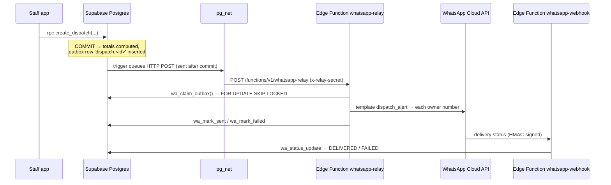

# WhatsApp Notification Engine (Supabase Edge Functions + Meta Cloud API)

## How it works



- **Transactional outbox.** The alert row is written in the same transaction as the sale. You never get an alert for a sale that failed, and never miss one for a sale that succeeded.
- **Retries.** `pg_cron` runs every 2 minutes and calls the relay only if something is pending or failed. Back-off is 2, 4, 8 … up to 240 minutes, for 8 attempts, then the row is marked `DEAD`. Recipients already reached are remembered, so a retry never double-sends.
- **EOD digest.** `pg_cron` runs at **15:00 UTC = 20:30 IST** → `app.enqueue_eod_digest()` inserts `eod:<date>` (unique) → the same relay sends it. It's guaranteed once per day.
- Delivery status is visible to the owner in the app (Team tab → "WhatsApp alerts").

## 1. Meta setup (once)
1. business.facebook.com → complete **Business Verification**.
2. developers.facebook.com → create an app (type *Business*) → add **WhatsApp**.
3. Add and verify the business phone number; note its **Phone number ID**.
4. Business Settings → **System users** → create one (Admin) → generate a **permanent token** with `whatsapp_business_messaging` + `whatsapp_business_management`.
5. App settings → Basic → copy the **App secret**.
6. Each owner who receives alerts should message the business number once (opt-in).

## 2. Templates to submit (WhatsApp Manager → Message templates)
Category **Utility**, language **English (`en`)**. Meta rejects templates that start or end with a
variable, hence the fixed closing sentence. The relay strips newlines and tabs from values and
shortens long item lists to "… +N more".

**`dispatch_alert`**
```
Dispatch Alert - {{1}} | Customer: {{2}} | Invoice #: {{3}} | Customer GSTIN: {{4}} | Sales Agent: {{5}} | Items: {{6}} | Total Excl. GST: {{7}} | Total Incl. GST: {{8}} | Transport: {{9}} | Sent automatically by WH Reg.
```
Sample values: `Warehouse A – Bengaluru` · `Sri Hardware & Sanitary` · `WHA/26-27/00001` · `29AABCS5678L1ZM` · `Manjunath` · `Impact Drill GSB 13 RE x40 PCS; Nylon Wall Plug SX 8x40 x1 CTN` · `₹1,25,200.00` · `₹1,47,736.00` · `VRL Logistics · KA01AB1234 · Driver 9845012345`

**`eod_digest`**
```
EOD Warehouse Digest ({{1}}) | {{2}} | Combined Sales: {{3}} | Critical Low Stock SKUs: {{4}} | Sent automatically by WH Reg.
```
Sample: `2026-11-10` · `Warehouse A Total: ₹1,65,294.40 | Warehouse B Total: ₹0.00` · `₹1,65,294.40` · `WHB:STN-CS-1724 x0 (min 20)`


### Reminders and the owner's daily summary (added 13-Nov-2026)
A 5-minute `pg_cron` job (`whreg-schedules` → `app.run_schedules()`) queues these once per day, at the
times set by the owner in **Settings → Reminders & daily summary** (defaults below). Each one is also
saved as an in-app notification (the bell), so they work even before WhatsApp is connected.

| Template | When (default) | To | Variables |
|---|---|---|---|
| `clock_in_reminder` | 09:00 on working days (Mon–Sat) | each employee not clocked in | {{1}} first name, {{2}} date |
| `clock_out_reminder` | 18:30 on working days | each employee still clocked in | {{1}} first name, {{2}} clock-in time |
| `daily_owner_summary` | 20:00 every day | owner's mobile + extra numbers | {{1}} date, {{2}} sales, {{3}} purchases, {{4}} attendance, {{5}} market runs |

Submit these three templates (category **Utility**, language **English `en`**):

**`clock_in_reminder`**
```
Good morning {{1}}. This is a reminder to clock in for today ({{2}}) in the WH Reg app before you start work. Thank you.
```
Sample: `Ravi` · `13 Nov 2026`

**`clock_out_reminder`**
```
Hello {{1}}. You have been clocked in since {{2}} today. Please remember to clock out in the WH Reg app before you leave. Thank you.
```
Sample: `Ravi` · `09:05 AM`

**`daily_owner_summary`**
```
Daily summary for {{1}} | Sales: {{2}} | Purchases: {{3}} | Attendance: {{4}} | Market runs: {{5}} | Full details in WH Reg → Daily report.
```
Sample: `13 Nov 2026 (Fri)` · `4 bills, ₹1,25,400 incl. GST. To: Sri Hardware ₹62,000; Venkat Traders ₹40,400; +2 more. Payments received: ₹30,000` · `1 bills, ₹2,10,000. From: Tata Agrico ₹2,10,000` · `Ravi 09:02 AM-06:41 PM (9.6h); Kumar absent` · `Ravi: Puttur, Tirupati, 6 customers, 2 orders`

Employees' numbers come from **Staff logins → Edit → Mobile**; the owner's from the owner login's mobile
plus any extra numbers in the settings card. Each recipient should send one message ("Hi") to the business
number once, so WhatsApp delivers reliably.

## 3. Function secrets (Supabase)
Create `supabase/functions/.env.production` (git-ignored) from `.env.example`, then:
```bash
supabase secrets set --env-file supabase/functions/.env.production
```
| Secret | Value |
|---|---|
| `RELAY_SECRET` | long random string (same as the Vault secret below) |
| `LOGIN_EMAIL_DOMAIN` | `staff.whreg.app` (must match the app) |
| `WA_PHONE_NUMBER_ID`, `WA_ACCESS_TOKEN`, `WA_APP_SECRET` | from Meta |
| `WA_WEBHOOK_VERIFY_TOKEN` | any random string |
| `WA_OWNER_NUMBERS` | `9198XXXXXXXX,9199XXXXXXXX` (no `+`) |
| `WA_GRAPH_VERSION` | a currently supported Graph API version, e.g. `v24.0` |
| `WA_DRY_RUN` | `false` once the templates are approved |

## 4. Vault secrets (so Postgres can call the relay)
Run once in the SQL editor:
```sql
select vault.create_secret('https://<project-ref>.supabase.co', 'project_url');
select vault.create_secret('<same value as RELAY_SECRET>', 'whatsapp_relay_secret');
```
Until both exist, sales still work and alerts simply wait in the outbox.

## 5. Webhook
Meta app → WhatsApp → Configuration:
- Callback URL: `https://<project-ref>.supabase.co/functions/v1/whatsapp-webhook`
- Verify token: `WA_WEBHOOK_VERIFY_TOKEN`
- Subscribe to **messages**.

Unsigned or wrongly signed calls are rejected.

## 6. Cost
Meta bills **per delivered template message**. India utility rates are among the lowest
categories; check Meta's current rate card. Volume is roughly (invoices per day × owner numbers)
+ 1 digest per owner per day. Edge Function and pg_cron usage at this volume sits comfortably
inside Supabase plan quotas.

## 7. Troubleshooting
| Symptom | Look at |
|---|---|
| Nothing arrives | `select status, attempts, last_error from notification_outbox order by id desc limit 20;` |
| Rows stay `PENDING` | Vault secrets missing/wrong (§4); check `select * from net._http_response order by id desc limit 5;` |
| `last_error` mentions parameter count | Meta template must have exactly 9 / 4 variables |
| `DEAD` rows | Non-retryable (bad token, template not approved, number not on WhatsApp). Fix the cause, then `update notification_outbox set status='PENDING', attempts=0 where status='DEAD';` |
| Edge Function logs | Dashboard → Edge Functions → whatsapp-relay → Logs |
