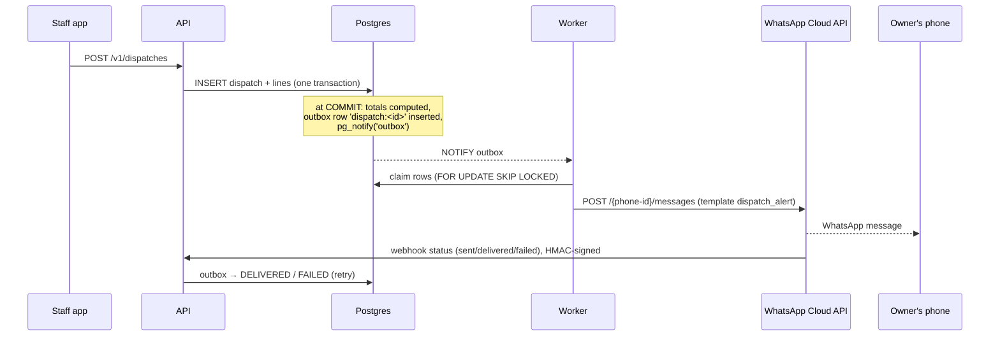

# WhatsApp Notification Engine (Meta WhatsApp Business Cloud API)

## How it works



- **Transactional outbox**: the alert row is written in the same transaction as the sale, so you never get an alert for a sale that failed, and never miss one for a sale that succeeded.
- **Retries**: exponential back-off (2, 4, 8 … max 240 min), 8 attempts, then `DEAD`. Recipients already reached are tracked in `payload.sent_to` so retries don't double-send.
- **EOD digest**: `croner` fires at **20:30 Asia/Kolkata**, inserts `eod:<date>` (unique) and sends — running several worker replicas still sends exactly one digest.

## 1. One-time Meta setup
1. business.facebook.com → complete **Business Verification**.
2. developers.facebook.com → create an app (type *Business*) → add **WhatsApp**.
3. Add and verify your business phone number; note the **Phone number ID**.
4. Business Settings → **System users** → create one with *Admin* → generate a **permanent token** with `whatsapp_business_messaging` and `whatsapp_business_management`.
5. App settings → Basic → copy the **App secret** (for webhook signatures).
6. Each owner receiving alerts must have WhatsApp on that number and should opt in (e.g. message the business number once).

## 2. Templates to submit (WhatsApp Manager → Message templates)

Category **Utility**, language **English** (`en`). Meta rejects templates that begin or end with a variable, hence the fixed trailing sentence. Body parameters cannot contain newlines or tabs; the worker sanitises every value and truncates long item lists to "… +N more".

### `dispatch_alert`
```
Dispatch Alert - {{1}} | Customer: {{2}} | Invoice #: {{3}} | Customer GSTIN: {{4}} | Sales Agent: {{5}} | Items: {{6}} | Total Excl. GST: {{7}} | Total Incl. GST: {{8}} | Transport: {{9}} | Sent automatically by WH Reg.
```
Sample values for review:
`Warehouse A – Bengaluru` · `Sri Hardware & Sanitary` · `WHA/26-27/00001` · `29AABCS5678L1ZM` · `Manjunath` · `Impact Drill GSB 13 RE x40 PCS; Nylon Wall Plug SX 8x40 x1 CTN` · `₹1,25,200.00` · `₹1,47,736.00` · `VRL Logistics · KA01AB1234 · Driver 9845012345`

### `eod_digest`
```
EOD Warehouse Digest ({{1}}) | {{2}} | Combined Sales: {{3}} | Critical Low Stock SKUs: {{4}} | Sent automatically by WH Reg.
```
Sample: `2026-11-10` · `Warehouse A Total: ₹1,65,294.40 | Warehouse B Total: ₹0.00` · `₹1,65,294.40` · `WHB:STN-CS-1724 x0 (min 20); WHB:FIS-SX8 x0 (min 2000)`

> Template `{{2}}` lists every active warehouse, so a third warehouse needs no new template.

## 3. Environment
```
WA_GRAPH_VERSION=v24.0         # keep on a supported Graph API version
WA_PHONE_NUMBER_ID=...
WA_ACCESS_TOKEN=...            # system-user token
WA_APP_SECRET=...
WA_WEBHOOK_VERIFY_TOKEN=...    # any random string; same value in Meta webhook config
WA_OWNER_NUMBERS=9198XXXXXXXX,9199XXXXXXXX   # E.164 without '+'
WA_DRY_RUN=false
```

## 4. Webhook
App → WhatsApp → Configuration → Callback URL `https://api.yourdomain.in/webhooks/whatsapp`,
Verify token = `WA_WEBHOOK_VERIFY_TOKEN`, subscribe to **messages**. The API verifies
`X-Hub-Signature-256` (HMAC-SHA256 of the raw body with the app secret) and rejects unsigned calls.

## 5. Cost
Meta bills **per delivered template message** (per-message pricing since 1 July 2025); utility
templates in India are among the cheapest categories. Rough volume: (dispatches per day × owner
numbers) + 1 digest per owner per day. Check Meta's current India rate card before go-live.

## 6. Troubleshooting
| Symptom | Look at |
|---|---|
| Nothing arrives | `SELECT status, attempts, last_error FROM notification_outbox ORDER BY id DESC LIMIT 20;` |
| `last_error` mentions parameter count | Template text in Meta must have exactly 9 / 4 variables |
| `DEAD` rows | Non-retryable error (bad token, template not approved, number not on WhatsApp). Fix, then `UPDATE notification_outbox SET status='PENDING', attempts=0 WHERE status='DEAD';` |
| Two EOD digests | Impossible by design (`dedupe_key`); check for two different templates/numbers |
